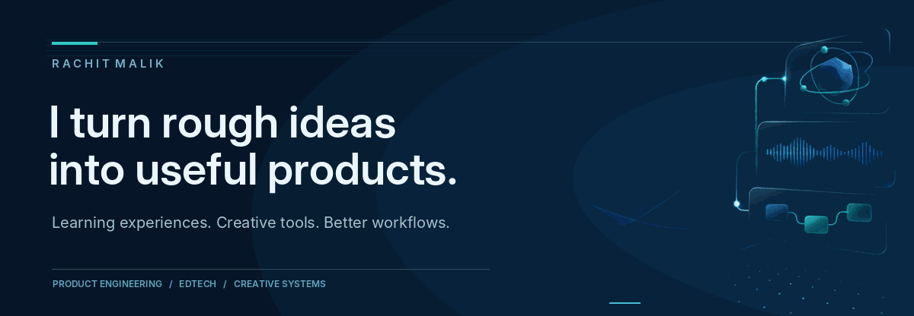
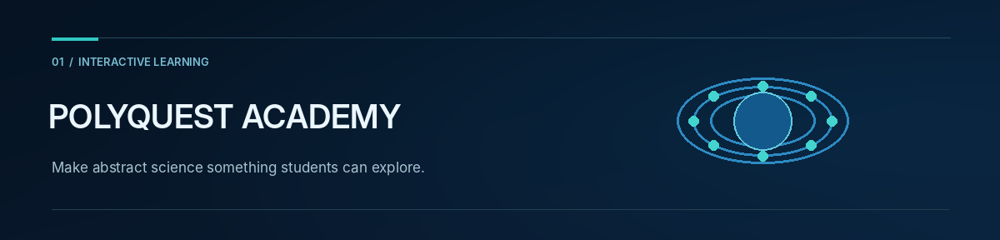
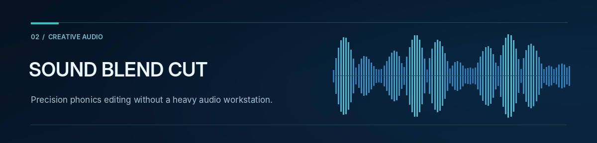
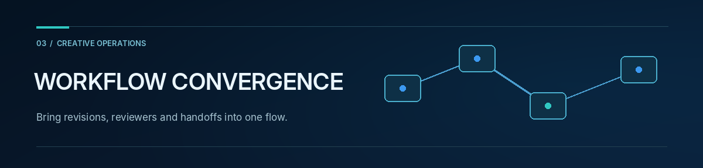
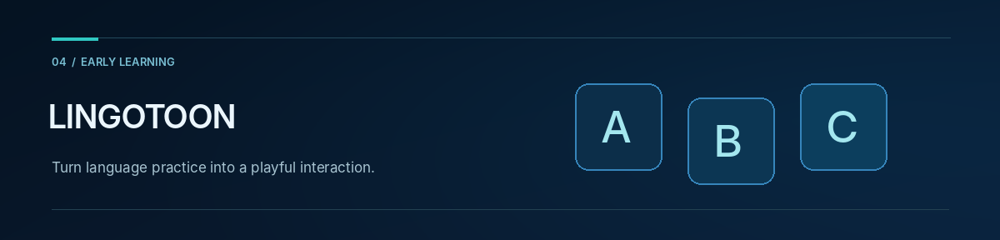
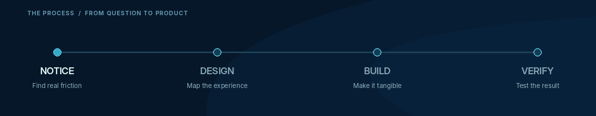

<!-- Rachit Malik — profile README -->
<!-- All illustrations are original conceptual portfolio graphics, not application screenshots. -->

  

  <a href="https://github.com/rachitmalik-byte?tab=repositories"><b>Explore the work</b></a>
  &nbsp;&nbsp;·&nbsp;&nbsp;
  <a href="https://github.com/rachitmalik-byte/sound-blend-cut"><b>Explore a creative tool</b></a>
  &nbsp;&nbsp;·&nbsp;&nbsp;
  <a href="https://github.com/rachitmalik-byte/WC2"><b>Explore a workflow system</b></a>

 

## The work starts with a problem, not a framework.

A science idea that is difficult to explain on a flat page. A phonics sound that takes too long to edit. A creative review that gets lost between spreadsheets and chat threads.

These are the kinds of problems that pull me in.

I'm **Rachit Malik** — a product-focused builder working at the intersection of **learning experiences, creative engineering, and operational systems**. I like turning an unclear problem into a usable interface, then working toward making that interface more reliable, accessible, and measurable.

 

### 01 / MAKE LEARNING EXPERIENTIAL

**PolyQuest Academy** explores how interactive science simulations and teacher-facing tools can make abstract subjects easier to teach and investigate.

`React` · `TypeScript` · `Three.js` · `Zustand`  
[Repository and code](https://github.com/rachitmalik-byte/verson2-kidos)

 

### 02 / REMOVE FRICTION FROM CREATIVE WORK

**Sound Blend Cut** is a browser-based phonics audio editing project built around a specific production need: precise sound manipulation without the overhead of a general-purpose audio workstation.

`JavaScript` · `Web Audio API` · `Digital audio processing`  
[Repository and code](https://github.com/rachitmalik-byte/sound-blend-cut)

 

### 03 / MAKE COMPLEX WORK TRACEABLE

**Workflow Convergence (WC 2.0)** is an operations prototype for organizing multi-stage reviews, revisions, ownership, and feedback across creative production work.

`React` · `TypeScript` · `Supabase` · `SQL`  
[Repository and code](https://github.com/rachitmalik-byte/WC2)

 

### 04 / DESIGN FOR CURIOSITY

**LingoToon** is an experiment in interactive language learning: games, feedback, and playful interfaces designed to make practice feel less passive.

`React` · `JavaScript` · `Motion & interaction`  
[Repository and code](https://github.com/rachitmalik-byte/lingotoon)

 

## How I approach the work

  

I care about the space between **a clever demo** and **a dependable product**. That means designing the interaction, understanding the data model, examining access controls, checking edge cases, and being honest about what is still a prototype.

 

## Tools I work with

| Interface & interaction | Data & systems | Creative engineering |
|:--|:--|:--|
| React · TypeScript · JavaScript | Supabase · PostgreSQL · SQL | Web Audio API · Three.js · Framer Motion |
| UI architecture · Responsive design | Workflow modeling · Data analysis | Simulations · Interactive learning |

 

## Currently improving

- **Reliability:** automated checks, authorization policies, accessibility, and clearer documentation.
- **Data thinking:** SQL-driven operational analysis and product metrics.
- **Product storytelling:** real demos, design decisions, and measurable outcomes for each flagship project.

 

---

  <b>Thoughtful interfaces. Useful systems. Continual iteration.</b> 
  Explore the repositories to see the code, experiments, and progress behind the work.  
  <a href="https://github.com/rachitmalik-byte?tab=repositories">ALL PROJECTS</a>

